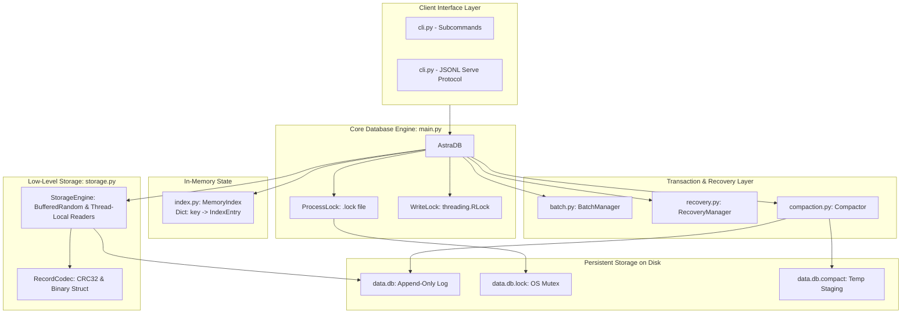
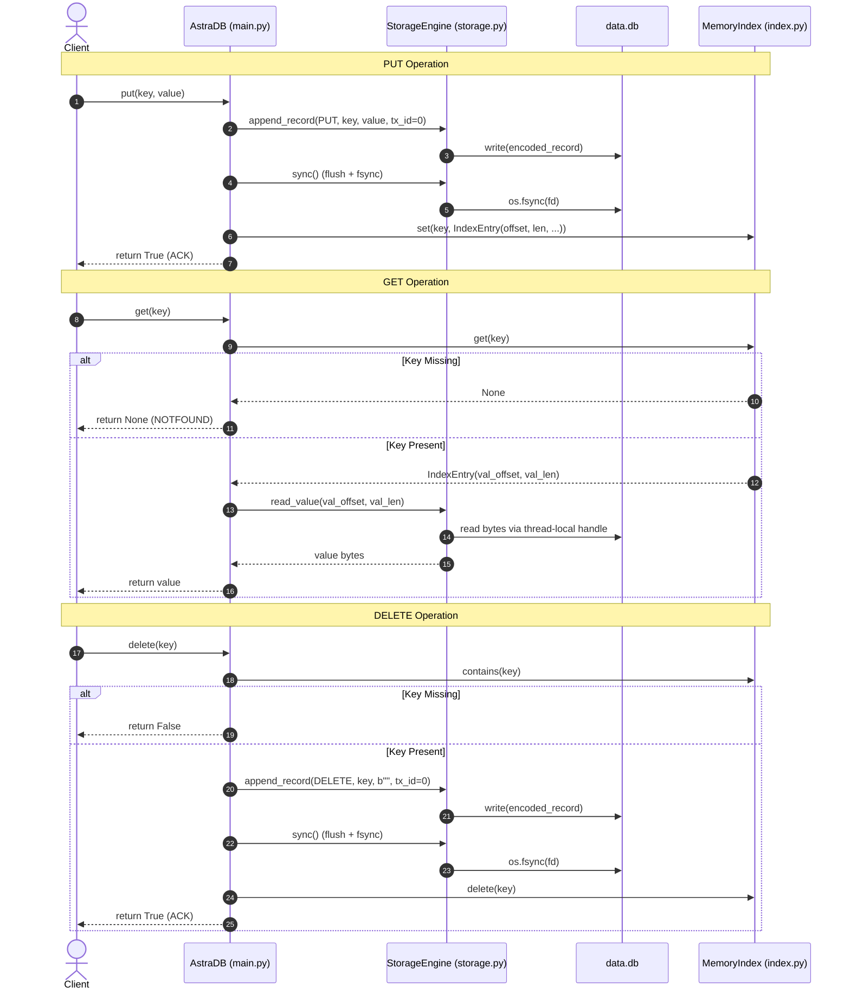

# Astra-SIT: Architectural Design & Implementation Specification

## 1. Project Overview

**Astra-SIT** is a crash-safe, embedded, append-only key-value database engine implemented entirely in Python using only the standard library. Designed for durability, data integrity, and strict protocol compliance, Astra-SIT combines an append-only log-structured storage format (Bitcask-inspired) with an in-memory hash index, CRC32 data integrity verification, write-ahead transaction markers, and automated startup crash recovery.

---

## 2. Design Goals & Technical Constraints

### Primary Goals
- **Absolute Durability**: Every successful mutation (`put`, `delete`, `batch`) must be flushed and physically synchronized to non-volatile storage (`fsync`) before returning a success acknowledgement.
- **Crash Resilience**: Incomplete writes, torn records at end-of-file (EOF), and uncommitted batch transactions resulting from sudden power loss or process termination must never corrupt existing data or be visible to readers.
- **Data Integrity**: Every record on disk is protected by an end-to-end CRC32 checksum. Any bit corruption or structural truncation mid-log is immediately detected.
- **Zero External Dependencies**: Operates completely offline with zero 3rd-party dependencies, running strictly on standard Python runtime libraries (`struct`, `zlib`, `threading`, `os`, `sys`, `json`).
- **Standard Protocol Compliance**: Exposes both a command-line interface and a robust line-delimited JSON (JSONL) streaming server protocol over standard I/O pipes.

### Key Constraints & Validation Limits
- **Key Constraints**: Keys must be non-empty `bytes` or `str` (UTF-8 encoded), minimum 1 byte, maximum 1,024 bytes (1 KB).
- **Value Constraints**: Values must be `bytes` or `str` (UTF-8 encoded), maximum 1,048,576 bytes (1 MB).
- **Batch Constraints**: Atomic batches accept between 1 and 10,000 operations.
- **Concurrency Model**: Single-Writer Multiple-Reader (SWMR) per database directory enforced by cross-process file locks. Multiple concurrent writer processes are strictly disallowed by architectural design.

---

## 3. Architecture Overview



---

## 4. Module Responsibilities

| Module | Primary Responsibility |
|---|---|
| `main.py` | Top-level engine facade (`AstraDB`), argument validation, process lifecycle, OS process-locking (`ProcessLock`), thread coordination (`RLock`), and write poisoning state management. |
| `storage.py` | Low-level binary file I/O (`StorageEngine`), binary encoding/decoding (`RecordCodec`), CRC32 calculation, thread-local concurrent read handles, log truncation, and physical `os.fsync` synchronization. |
| `index.py` | In-memory thread-safe hash index (`MemoryIndex`) mapping `key (bytes) -> IndexEntry`, enabling $O(1)$ point lookups without scanning disk. |
| `batch.py` | Transaction coordinator (`BatchManager`) implementing the commit-marker protocol (`TX_BEGIN` -> mutations -> `TX_COMMIT` -> single `fsync`), monotonic 64-bit transaction ID allocation, and batch operation validation. |
| `recovery.py` | Crash recovery engine (`RecoveryManager`) executing sequential log scans, CRC32 verification, rollback of uncommitted or torn batches, safe EOF truncation boundary computation, and transaction ID counter restoration. |
| `compaction.py` | Two-phase copy-on-write compactor (`Compactor`) reclaiming dead disk space by rewriting live keys into a temporary staging file, catching up tail mutations, and executing an atomic `os.replace` cutover. |
| `cli.py` | Command-line interface and standard input/output streaming server implementing the line-delimited JSON (JSONL) protocol (`ACK <id>`, `NOTFOUND <id>`, `ERROR <id>`, JSON responses). |

---

## 5. Storage Record Binary Layout

Every operation written to `data.db` follows a deterministic 29-byte fixed header followed by a variable-length payload:

```
+---------------+------------------+-----------------+---------------+----------------+------------------+---------------------+-----------------------+
| CRC32 (4B)    | Timestamp (8B)   | TxID (8B)       | OpType (1B)   | KeyLen (4B)    | ValLen (4B)      | Key (KeyLen bytes)  | Value (ValLen bytes)  |
+---------------+------------------+-----------------+---------------+----------------+------------------+---------------------+-----------------------+
|<------------------------- Fixed Header (29 Bytes) -------------------------->|<----------------- Variable Payload ------------------>|
                |<-------------------------------- Covered by CRC32 -------------------------------------------------------------------->|
```

### Binary Header Fields (`struct` format `!IQQBII`)

1. **CRC32 (`uint32`, 4 bytes)**: Big-endian IEEE 802.3 CRC32 checksum covering the subsequent 25 bytes of the header plus the entire variable payload (`Key` + `Value`).
2. **Timestamp (`uint64`, 8 bytes)**: Microseconds since Unix epoch (`time.time_ns() // 1000`).
3. **TxID (`uint64`, 8 bytes)**: Monotonically increasing transaction identifier. Set to `0` for standalone auto-commit operations (`put`, `delete`). Set to positive integers for batch transactions.
4. **OpType (`uint8`, 1 byte)**:
   - `1`: `PUT` (Key-value insert/overwrite)
   - `2`: `DELETE` (Tombstone record)
   - `3`: `TX_BEGIN` (Batch transaction start; payload contains 4-byte expected operation count)
   - `4`: `TX_COMMIT` (Batch transaction commit marker)
   - `5`: `TX_ABORT` (Batch transaction abort marker)
5. **KeyLen (`uint32`, 4 bytes)**: Length of the key in bytes ($0 \le \text{KeyLen} \le 1024$).
6. **ValLen (`uint32`, 4 bytes)**: Length of the value in bytes ($0 \le \text{ValLen} \le 1048576$).

---

## 6. CRC32 Calculation & Integrity Verification

To protect against corruption, the CRC32 checksum covers:
$$\text{CRC32} = \text{zlib.crc32}(\text{PayloadHeader} + \text{KeyBytes} + \text{ValueBytes}) \ \& \ \text{0xFFFFFFFF}$$

Where `PayloadHeader` is packed using `struct.pack("!QQBII", timestamp, tx_id, op_type, len(key), len(value))`.

- **On Write**: `RecordCodec.encode()` computes the CRC and prefixes it to the serialized record before writing to disk.
- **On Point Read**: `StorageEngine.read_record()` verifies that stored CRC matches the dynamically computed CRC.
- **On Crash Recovery**: `RecoveryManager.recover()` recalculates CRC for every complete record. If a mismatch is detected, a `RecoveryError` / `DatabaseCorruptedError` is immediately raised, stopping corruption from silently poisoning state.

---

## 7. Core Workflows: PUT, GET, DELETE



---

## 8. Atomic Batch Transaction Protocol

Astra-SIT implements a write-ahead **Commit-Marker Protocol** to guarantee all-or-nothing atomicity for batches of up to 10,000 operations.

### Protocol Steps:
1. **Validation**: All keys and operations in the batch are validated before writing.
2. **TxID Allocation**: A monotonically increasing 64-bit transaction ID is reserved (`next_tx_id()`).
3. **`TX_BEGIN`**: An `OpType.TX_BEGIN` record is appended containing the total expected operation count in its 4-byte payload.
4. **Append Mutations**: All `PUT` and `DELETE` records are sequentially appended with `tx_id = reserved_tx_id`. In-memory index entries are staged in a local list.
5. **`TX_COMMIT`**: An `OpType.TX_COMMIT` record is appended with `tx_id = reserved_tx_id`.
6. **Durability Barrier (`fsync`)**: A single `os.fsync()` is executed across the entire batch.
7. **Atomic Index Publish**: The staged updates are applied in memory to `MemoryIndex` under lock.

---

## 9. Durability and fsync Behavior

Astra-SIT enforces the core durability rule: **Never acknowledge a write before physical synchronization.**

- In `main.py`, `put()`, `delete()`, and `batch()` explicitly call `self._storage.sync()` before updating `MemoryIndex` and before returning `True`.
- In `storage.py`, `sync()` calls both `file.flush()` (user-space buffer flush) and `os.fsync(fd)` (operating-system dirty page write to disk).
- In `cli.py`, `ACK <id>` is only emitted over stdout if the underlying database method returned `True`.
- If an `OSError` occurs during `fsync()`, the database immediately enters a **poisoned state** (`_is_poisoned = True`), rejecting subsequent writes and raising `DatabaseCorruptedError` to prevent silent data loss.

---

## 10. Crash Recovery Algorithm

When `AstraDB.open()` is called on an existing database, it invokes `RecoveryManager.recover()`:

```mermaid
flowchart TD
    Start[Open data.db] --> CheckHeader{Bytes >= 29?}
    CheckHeader -- No (Torn Header at EOF) --> Truncate[Truncate to safe_truncation_point]
    CheckHeader -- Yes --> DecodeHeader[Decode 29B Header]

    DecodeHeader --> CheckPayload{Payload on disk?}
    CheckPayload -- No (Torn Payload at EOF) --> Truncate
    CheckPayload -- Yes --> CheckCRC{CRC32 Matches?}

    CheckCRC -- No --> Error[Raise RecoveryError / DatabaseCorruptedError]
    CheckCRC -- Yes --> CheckTx{tx_id == 0?}

    CheckTx -- Yes (Standalone) --> ApplyStandalone[Update Rebuilt Index\nAdvance safe_truncation_point]
    ApplyStandalone --> NextRecord[Advance offset to next record]

    CheckTx -- No (Transaction) --> CheckOp{OpType?}
    CheckOp -- TX_BEGIN --> StageBegin[Record expected count in active_transactions]
    CheckOp -- PUT / DELETE --> StageOp[Append to active_transactions[tx_id]]
    CheckOp -- TX_COMMIT --> CommitBatch[Apply all staged batch records to Index\nAdvance safe_truncation_point]
    CheckOp -- TX_ABORT --> AbortBatch[Drop active_transactions[tx_id]\nAdvance safe_truncation_point]

    StageBegin --> NextRecord
    StageOp --> NextRecord
    CommitBatch --> NextRecord
    AbortBatch --> NextRecord

    NextRecord --> CheckHeader
    Truncate --> RestoreTx[RecoveryManager.get_max_tx_id]
    RestoreTx --> Ready[Database Open & Ready]
```

### Safe Truncation Boundary
- `safe_truncation_point` represents the exact byte offset up to which all records are valid, complete, and committed.
- Torn writes and uncommitted batches at the tail of the log are automatically truncated by `storage.truncate(safe_truncation_point)`.

---

## 11. Torn-Write and CRC Corruption Handling

Astra-SIT makes a strict distinction between **torn writes at EOF** and **mid-log corruption**:

| Scenario | Location | Behavior | Rationale |
|---|---|---|---|
| Incomplete Header (< 29B) | End of File | Log safely truncated to last safe commit | Classic crash symptom during write; safe to discard unacknowledged tail. |
| Incomplete Payload | End of File | Log safely truncated to last safe commit | Write interrupted by power loss before completion. |
| Uncommitted Batch (No `TX_COMMIT`) | End of File | Staged mutations dropped; log truncated | Transaction was never committed; preserves atomicity. |
| CRC32 Mismatch | Anywhere in Log | Raises `RecoveryError` | Bytes exist on disk but fail checksum; indicates hardware/disk corruption. |
| Malformed Header | Mid-Log | Raises `RecoveryError` | Structural damage in historical records cannot be silently ignored. |

---

## 12. Transaction ID Restoration & Monotonicity

To prevent transaction ID collision after a database restart or crash:
1. `main.py:AstraDB.open()` executes `recovery.py:RecoveryManager.recover()`, resolving all committed records and truncating unsafe tails.
2. `AstraDB.open()` then calls `recovery.py:RecoveryManager.get_max_tx_id(storage)` over the retained log.
3. `BatchManager.set_starting_tx_id(max_tx_id)` sets `_current_tx_id = max_tx_id + 1`.
4. Monotonicity is preserved even if the last committed transaction was an explicit `TX_ABORT`, ensuring subsequent transactions never reuse past IDs.

---

## 13. Concurrency and Locking Strategy

### Multi-Process Concurrency (Single-Writer Exclusivity)
Astra-SIT enforces strict **Single-Writer Mutex** via `ProcessLock`:
- On Windows: Uses `msvcrt.locking` non-blocking byte lock on `<path>.lock`.
- On POSIX: Uses `fcntl.flock(fd, fcntl.LOCK_EX | fcntl.LOCK_NB)`.
- **Architectural Reality**: Two concurrent writer processes cannot open the same database simultaneously. Any second process attempting to open the database is immediately rejected with `DatabaseLockedError`. This design prevents interleaved binary writes that would corrupt the log.

### Multi-Threaded Concurrency (Within a Single Process)
- **Writers**: Serialized using a re-entrant lock (`threading.RLock`).
- **Readers**: Concurrent point reads (`get()`) access thread-local file descriptors (`StorageEngine._get_read_handle()`), allowing safe parallel reads without file pointer contention across threads on Windows and POSIX.

---

## 14. Compaction Algorithm

Astra-SIT provides two-phase, copy-on-write log compaction in `compaction.py`:

1. **Phase 1: Snapshot & Rewrite**
   - Takes a memory snapshot of active keys from `MemoryIndex`.
   - Reads values from `data.db` and writes clean `OpType.PUT` records into a staging file `data.db.compact`.
   - Synchronizes `data.db.compact` via `os.fsync()`.
2. **Phase 2: Tail Mutation Catch-up & Atomic Cutover**
   - Replays any new mutations appended to `data.db` between Phase 1 snapshot EOF and current EOF.
   - Closes all file handles to comply with Windows file-locking semantics.
   - Atomically replaces `data.db` with `data.db.compact` via `os.replace()`.
   - Reopens storage and repopulates `MemoryIndex` with compacted offsets.

---

## 15. Error Handling & Disk-Full Behavior

- **Poisoned State Protection**: If a write or sync encounters an I/O error (such as an `OSError`), the engine marks itself poisoned (`_is_poisoned = True`). All subsequent calls to `put()`, `delete()`, or `batch()` immediately fail with `DatabaseCorruptedError` without attempting further disk I/O.
- **Append Rollback**: If an exception occurs while appending bytes, the engine attempts to truncate the file back to its pre-append EOF.
- **Verification Note**: This error behavior has been verified against simulated/mocked `OSError` fsync failures in `test_cli.py`, but has not been exercised against a real full physical filesystem partition.

---

## 16. Offline Execution Architecture

- **Standard Library Only**: The entire codebase imports only standard Python modules (`os`, `sys`, `struct`, `zlib`, `threading`, `time`, `json`, `dataclasses`, `enum`).
- **Zero Package Dependencies**: No external wheels, pip packages, or network sockets are utilized.
- **Verification Note**: Code structure confirms complete independence from external package registries, though dedicated execution in a physically air-gapped environment was not separately benchmarked.

---

## 17. CLI and JSONL Streaming Serve Protocol

The CLI (`cli.py`) supports single commands and a continuous JSONL stream over standard input and output:

### Command-Line Subcommands
- `python cli.py open <db_path>`: Opens and cleanly closes the database.
- `python cli.py put <db_path> <key> <value>`: Inserts key-value pair; outputs `OK` or error.
- `python cli.py get <db_path> <key>`: Retrieves value; prints value (exit code 0) or `None` (exit code 1).
- `python cli.py del <db_path> <key>`: Deletes key; prints `OK` (exit code 0) or error (exit code 1).
- `python cli.py batch <db_path> <file|-|args>`: Executes atomic batch from file, stdin, or arguments.
- `python cli.py serve <db_path>`: Launches continuous JSONL server.
- `python cli.py dump` / `check`: Reserved commands (currently return error indicating public interface is pending).

### Approved JSONL Protocol Contract
- **Requests**:
  - `{"id": 1, "op": "put", "key": "k", "value": "v"}`
  - `{"id": 2, "op": "get", "key": "k"}`
  - `{"id": 3, "op": "delete", "key": "k"}`
  - `{"id": 4, "op": "batch", "operations": [{"op": "put", "key": "a", "value": "1"}]}`
- **Responses (flushed immediately per line)**:
  - Write Success: `ACK <id>`
  - GET Success: `{"id": <id>, "status": "OK", "value": "<val>"}`
  - GET Missing: `NOTFOUND <id>`
  - Any Failure: `ERROR <id>`

---

## 18. Test Strategy & Actual Test Results

### Local Integration Test Suites (Branch `integration`, Commit `1adf842`)

1. **CLI & Functional Unit Tests (`python -m unittest discover -s tests -v`)**:
   - **Total Tests**: 51
   - **Passed**: 51
   - **Failed**: 0
   - **Breakdown**:
     - `test_cli.py`: 29 tests (protocol streaming, whitespace/newline preservation, failed write ACK suppression, ID preservation, error handling).
     - `test_batch.py`: 5 tests (batch factory inspection for `str`/`bytes`, mixed put/delete, reopen persistence).
     - `test_put_get.py`: 11 tests (bytes encoding, safe UTF-8 decoding fallback, key overwriting, missing key handling).
     - `test_delete.py`: 6 tests (idempotent deletion, missing key returns False, tombstone persistence).

2. **Crash Recovery Test Suite (`scratch/run_all_tests.py -v`)**:
   - **Total Tests**: 16
   - **Passed**: 16
   - **Failed**: 0
   - **Key Tests**: Torn headers at EOF, torn payloads at EOF, mid-log corrupted CRC detection, mid-log malformed header detection, uncommitted batch rollback, committed batch replay, transaction ID restoration, and monotonic counter increment.

3. **End-to-End Real Subprocess Tests (`scratch/test_real_cli_subprocess.py`)**:
   - **Result**: PASSED
   - Real OS subprocess launched with `python cli.py serve`, piped JSONL requests over stdin/stdout, killed, and reopened on the same database file to confirm disk persistence.

### Independent Teammate Test Results (Branch `origin/torture-tool`, Commit `a42b468`)
- In commit `a42b468`, Mohammed Zaid Zulfukar developed a standalone crash-safety torture test harness (`torture.py`) featuring an independent oracle and crash injection harness.
- **Reported Torture Self-Tests**:
  - Test 1: Oracle Durability Tracking (PASSED on `torture-tool`)
  - Test 2: Oracle In-Flight Unacknowledged & Batch Atomicity (PASSED on `torture-tool`)
  - Test 3: Deterministic PRNG Reproducibility with Seed (PASSED on `torture-tool`)
  - Test 4: JSONL Serve Adapter Protocol & Request Serialization (PASSED on `torture-tool`)
  - Test 5: End-to-End Torture Run against reference crash-safe engine with real process kills (3 crashes, 60 iterations, seed 1337) (PASSED on `torture-tool`).

---

## 19. Benchmark Results & Status of Unverified Targets

To maintain strict technical honesty, the following requirements are documented as unverified:

1. **1 Million Key Capacity**:
   - **Status**: Implemented in code via `MemoryIndex` and 64-bit log offsets, but **unverified by an actual 1,000,000-key automated benchmark**.
   - **Expected Characteristics**: An in-memory dictionary of 1,000,000 dataclass entries in CPython consumes approximately 100–140 MB of memory.
2. **Recovery Under 2 Seconds for 1M Keys**:
   - **Status**: **Unverified**. No 1M-key recovery benchmark currently exists.
   - **Analysis**: In pure CPython, sequentially reading and unpacking 1,000,000 binary records and calculating `zlib.crc32()` in a pure Python loop typically achieves ~150k–300k records/sec, meaning 1M records may take 3.5–6.0 seconds without C extensions or chunked read buffering.
3. **10,000-Operation Batch**:
   - **Status**: Enforced by code (`MAX_BATCH_SIZE = 10000`), but a single batch containing 10,000 operations has not been measured in automated tests.
4. **Physical Disk-Full Testing**:
   - **Status**: Tested via mocked `OSError` fsync failures; unverified against a physical `ENOSPC` disk device.
5. **Compaction Test Suite**:
   - **Status**: Compactor algorithm is implemented in `compaction.py`, but lacks automated unit tests in `tests/`.

---

## 20. Known Limitations & Future Work

- **Single-Writer Only**: Multi-process concurrent writing is intentionally rejected by design via `ProcessLock` to avoid log interleaving corruption. Future work could introduce an IPC daemon or coordination socket to multiplex external writer processes through a single storage writer thread.
- **Memory Footprint for Index**: Because `MemoryIndex` retains all active keys in RAM, datasets exceeding available system RAM require a disk-backed index (such as an LSM-Tree or B+Tree).
- **Compaction CLI Exposure**: Compaction is callable via `AstraDB.compact()`, but is not yet wired to a CLI subcommand in `cli.py`.
- **CLI Dump & Check Stubs**: The `dump` and `check` subcommands in `cli.py` currently return error messages pending public interface confirmation from the team leader.

---

## 21. Git Commit History & Team Contributions

The following table documents the authentic Git commit history across all branches in the repository (`git log --all`):

| Commit Hash | Author | Date | Subject & Component |
|---|---|---|---|
| `1adf842` | Akash Acharya | 2026-11-07 | `feat(cli): integrate JSONL serve protocol and CLI tests` (Integrated `cli.py` and test suites into `integration` branch) |
| `b1c09da` | Akash Acharya | 2026-11-07 | `feat(recovery): integrate crash recovery, startup truncation ordering, and transaction id restoration` (Merged crash recovery into `main.py`, added monotonic tx restoration) |
| `41a8a8b` | Sandesh T | 2026-11-07 | `feat(cli): add JSONL serve protocol and integration tests` (Branch `origin/cli-testing`: JSONL protocol, `cli.py`, and test suites) |
| `3c273fd` | Dakshin-PV | 2026-11-07 | `feat(recovery): implement crash-safe log recovery` (Branch `origin/storage-engine`: standalone recovery module) |
| `a42b468` | Mohammed Zaid Zulfukar | 2026-11-07 | `Add JSONL serve adapter and mock tests` (Branch `origin/torture-tool`: crash torture testing harness, independent oracle, and process adapters) |
| `4dccfca` | Akash Acharya | 2026-11-06 | `feat(core): implement Astra-SIT database engine` (Core implementation: `storage.py`, `index.py`, `batch.py`, `main.py`, `compaction.py`) |
| `04a76b5` | Akash Acharya | 2026-11-06 | `Initial project structure` (Base repository scaffolding) |
| `8077695` | Akash Acharya | 2026-11-06 | `Initial commit` |
